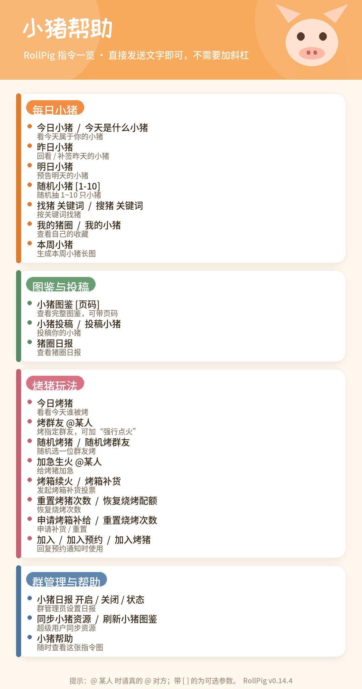

# 🐖 QQ Agent RollPig

> 文档性质：**使用说明**（面向安装者/用户）。本文只写安装、配置、使用和排障。

把 [RollPig Plus](https://github.com/Felis2026/nonebot-plugin-rollpig-plus) 的「今日小猪 / 猪圈成长 / 图鉴 / 烤群友 / 猪圈日报」等玩法，接到 **QQ Agent** 上。

它不是把原插件改写成 JavaScript，而是一个**适配层**：

- **QQ Agent 插件**（`plugin/`）：在消息进入活跃度/LLM 判定之前截住指令，交给侧车处理；
- **Python 侧车**（`sidecar/`）：原样加载上游 `nonebot-plugin-rollpig-plus`，继续用 Pillow 渲染卡片；
- 侧车不直接连 QQ，而是把要发的消息放进 outbox，由 QQA 插件用 QQA 自己的发送队列发出。

这样既保留了上游的完整渲染与玩法，又保证「今日小猪」**必定响应、不经过 LLM、不会被活跃度或其他回复管理插件过滤**。

> 适配上游版本：`nonebot-plugin-rollpig-plus 0.14.4`  
> 适配 QQA：`plugin.json` API v1  
> 本仓库代码：MIT；上游代码与第三方素材的许可见 [THIRD_PARTY_NOTICES.md](THIRD_PARTY_NOTICES.md)



---

## 目录

- [一、它是什么 / 不是什么](#一它是什么--不是什么)
- [二、功能](#二功能)
- [三、工作原理](#三工作原理)
- [四、环境要求与部署形态](#四环境要求与部署形态)
- [五、安装与部署](#五安装与部署)
- [六、配置](#六配置)
- [七、指令](#七指令)
- [八、和原版 RollPig 的关系](#八和原版-rollpig-的关系)
- [九、第三方资源与许可](#九第三方资源与许可)
- [十、官方市场包说明（重要）](#十官方市场包说明重要)
- [十一、故障排查](#十一故障排查)
- [十二、更多文档](#十二更多文档)
- [十三、License 与致谢](#十三license-与致谢)

---

## 一、它是什么 / 不是什么

**是：**

- 一个 QQ Agent **确定性插件**：命中固定指令时必定执行，不靠模型判断；
- 一个**同机 Python 侧车**：复用上游 NoneBot 插件和 Pillow 渲染器；
- 一个**旁路适配器**：在 `Orchestrator.onIncoming` 处截住指令，`markEntryRead` 后不再进入 QQA 的模型会话。

**不是：**

- 不是上游 RollPig Plus 的 fork，也没有把上游代码复制进本仓库；
- 不是纯 JS 插件：没有 Python 侧车时，指令会回退到 QQA 普通聊天流程；
- 不是「装进 `plugins/` 就能单独工作」的零依赖插件。**必须先部署侧车**，原因见[第十节](#十官方市场包说明重要)。

---

## 二、功能

| 模块 | 能力 |
| --- | --- |
| **今日小猪** | 每天一只固定小猪；`今日小猪` / `今天是什么小猪` 查看当天结果 |
| **昨日 / 明日** | 昨日回顾（可免费补签）、明日预测 |
| **随机 / 找猪** | `随机小猪 [1-10]`、`找猪 关键词` / `搜猪 关键词`（PigHub） |
| **猪圈成长** | `我的猪圈`、`小猪图鉴 [页码]`、`本周小猪`；重复抽取提升 EX Lv. |
| **烤猪互动** | `今日烤猪`、`烤群友 @目标`、`随机烤猪`、`加急生火`、预约烤猪、`烤箱续火` / `烤箱补货` |
| **猪圈日报** | `猪圈日报` 查卡；群主/管理员用 `小猪日报 开启/关闭/状态` 控制推送 |
| **投稿 / 资源** | `小猪投稿`；超级用户 `同步小猪资源` |
| **小猪帮助** | 本适配层新增：发一张全部指令的总览图；优先用 `helpImage` 设置指向的图（Docker 默认 `/media`，原生/Windows 填绝对路径），失败时用插件内置图兜底 |

上游的 **AI 烤猪**、**RollPig Cloud 多 Bot 同步**、**私有资源 Overlay** 仍然可用，但默认关闭/本地模式；配置方法沿用上游文档。

---

## 三、工作原理

```text
QQ 群消息
   │
   ▼
QQ Agent app.js ingestMessage()
   │  生成 entry（text / atMe / replyToSelf / mid ...）
   ▼
Orchestrator.onIncoming(chatKey, entry)
   │
   ├─ rollpig 插件 classify()
   │     ├─ 命中指令：store.markEntryRead()
   │     │             POST http://127.0.0.1:18765/event
   │     │             不调用原 onIncoming
   │     │             （因此不排模型会话、不产生 LLM 回复）
   │     └─ 未命中：original.call(...) 原样透传
   │
   ▼
Python 侧车（NoneBot 无头进程）
   │  上游 rollpig handler 抽猪 / 烤猪 / Pillow 渲染
   │  出站 API 不直接发 QQ，写入 outbox
   ▼
QQ Agent 插件轮询 GET /outbox
   │  sender.sendTextBatch / sendImage / sendMedia
   ▼
QQ（走 QQA 的串行、限频、去重、留档）
```

几个关键点：

1. **为什么不用 QQA 的 hook？**  
   `before-context` / `before-llm-messages` 等 hook 只在已经排定模型会话后才触发；关键词消息如果一开始就被活跃度判定丢掉，hook 根本看不到。因此适配器包了 `Orchestrator.prototype.onIncoming`，这是 QQA 生态里已有的旁路挂载方式。
2. **为什么侧车不直接发 QQ？**  
   直发会绕过 QQA 的发送队列，导致乱序、限频失效、重复刷屏、留档缺失。侧车只生产 outbox，QQA 插件负责真正发送并回传 `message_id`。
3. **图片怎么到 QQ？**
   侧车把图片写到 `$QQA_HOME/media/rollpig/...`，但“发给 QQA 的路径”不是写死的，由 `QQA_MEDIA_URL_PREFIX` 决定：

   - **Docker 双容器**：`/media`（宿主 media 同时挂给 `qq-agent` 和 `snowluma`）；
   - **原生安装**：媒体目录的绝对路径（侧车和 QQA 在同一台机器，QQA 直接读）；
   - 如果 QQA 与 Snowluma 不在同一台机器、也没有共享 media，本地图片路径无法互认，本方案不适用。

---

## 四、环境要求与部署形态

| 项 | 要求 |
| --- | --- |
| 系统 | Linux + systemd 可用（一键脚本）；Windows 需手动部署，见 [docs/windows.md](docs/windows.md) |
| 权限 | Linux 安装/服务需要 `root` 或 `sudo` |
| QQA | 默认 `/opt/qq-agent`；Docker 容器名 `qq-agent`，媒体目录挂载为 `/media` |
| Python | **3.10+**，且 `python3 -m venv` 可用（Linux 需要 `python3-venv`） |
| 资源 | 约 500MB 磁盘（venv + 上游包 + 资源）；运行时约 150–250MB 内存 |
| 网络 | 安装时需要访问 PyPI；国内可换镜像 |
| 端口 | 侧车默认只监听 `127.0.0.1:18765`，不对外开放 |

**支持矩阵（重要）：**

| 部署形态 | 状态 | 说明 |
| --- | --- | --- |
| Docker，`qq-agent` + `snowluma` 两个容器，共享 media | ✅ 已实测 | 默认 `/media` 前缀 |
| Linux 原生，QQA 与侧车同一台机器 | ✅ 支持 | `install.sh` 自动识别为 native，发送绝对路径 |
| 单容器 / 没有 Docker | ✅ 支持（native 模式） | 只要 QQA 进程能读到侧车写的绝对路径 |
| Windows 原生 QQA | ⚠️ 手动，未实测 | 插件已去掉 `/app/data` 写死，媒体前缀/帮助图可配置；侧车需手动装 Python/venv 并常驻，见 [docs/windows.md](docs/windows.md) |
| QQA 与 Snowluma 分机、无共享 media | ❌ 不支持 | 本地文件路径无法跨机，需改成共享存储或 URL 方案 |

> 如果 QQA 不在 `/opt/qq-agent`，安装时用 `QQA_HOME=/你的/qq-agent` 覆盖；侧车媒体目录会跟着变。
>
> 原生安装可显式指定：`sudo QQA_DEPLOY_MODE=native ./scripts/install.sh`。

---

## 五、安装与部署

### 5.1 一键安装（推荐）

```bash
# 1) 系统依赖（只需一次）
sudo apt-get update
sudo apt-get install -y python3 python3-venv python3-pip

# 2) 拉取仓库（把 <本仓库地址> 换成实际地址）
git clone <本仓库地址> qqa-rollpig
cd qqa-rollpig

# 3) 安装（默认 QQA_HOME=/opt/qq-agent）
sudo ./scripts/install.sh
```

QQA 不在默认路径时：

```bash
sudo QQA_HOME=/path/to/qq-agent ./scripts/install.sh
```

国内服务器安装 Python 依赖慢，可以指定镜像：

```bash
sudo PIP_INDEX_URL=https://mirrors.aliyun.com/pypi/simple/ \
     PIP_TRUSTED_HOST=mirrors.aliyun.com \
     ./scripts/install.sh
```

安装脚本会做这些事：

1. 检查 `python3` 版本和 `venv`；
2. 创建 `/opt/qq-agent/rollpig-service`，复制侧车代码；
3. 创建 venv，安装 `sidecar/requirements.txt`（含上游 `nonebot-plugin-rollpig-plus==0.14.4`）；
4. 首次安装时生成 `rollpig_config.json`（已存在则**保留**）；
5. 生成「小猪帮助」图片到 `media/rollpig/help/`；
6. 把 `plugin/` 复制到 `app/plugins/rollpig/`（旧目录会移到 `app/data/rollpig-backups/`，避免被 QQA 当成新插件扫描）；
7. 写入并启动 `rollpig-sidecar.service`（`systemctl enable` + `restart`）；
8. 等健康检查通过，`touch` 插件文件触发 QQA 热重载。

### 5.2 安装后验证

```bash
# 侧车健康检查
curl -s http://127.0.0.1:18765/health
# 期望：{"ok": true, "self_id": "...", "groups": ..., ...}

# 服务状态
systemctl status rollpig-sidecar --no-pager

# 最近日志
journalctl -u rollpig-sidecar -n 80 --no-pager
```

然后在 QQ Agent 控制台：

- 打开 **「插件」** 页签；
- 应看到 **「今日小猪（RollPig）」**，状态为已加载/已启用；
- 在群里发 `小猪帮助`，应收到指令总览图；
- 发 `今日小猪`，应收到小猪卡片，且**没有** AI 文字回复。

### 5.3 升级

```bash
cd qqa-rollpig
git pull
sudo ./scripts/install.sh
```

`install.sh` 会保留已有的 `rollpig_config.json`，只替换代码和插件；插件旧目录会备份。

### 5.4 卸载

```bash
# 只停服务、移除插件，保留配置和数据
sudo ./scripts/uninstall.sh

# 连服务目录、插件、帮助图一起删（数据目录默认保留）
sudo ./scripts/uninstall.sh --purge
```

数据默认在：

```text
/root/.local/share/nonebot2/nonebot_plugin_rollpig_plus
```

升级/卸载前建议备份这个目录。

### 5.5 Windows 原生 QQA

`install.sh` 依赖 systemd，**不能直接在 Windows 上跑**。Windows 需要手动：

1. 安装 Python 3.10+，创建 venv，`pip install -r sidecar/requirements.txt`；
2. 设置 `QQA_HOME`、`QQA_MEDIA_DIR`，并把 `QQA_MEDIA_URL_PREFIX` 设成
   QQA 能读到的**绝对路径**（例如 `C:/qq-agent/media`，不能是 `/media`）；
3. 用任务计划程序或 `start-rollpig.cmd` 常驻 `sidecar/server.py`；
4. 把 `plugin/` 复制到 `<QQA_HOME>/app/plugins/rollpig/`。

完整命令和注意事项见 [docs/windows.md](docs/windows.md)。

如果 Snowluma 跑在 WSL/容器里，Windows 绝对路径对它不可见，这种情况应改用 Docker
部署，或把媒体目录挂进 WSL/容器。

---

## 六、配置

### 6.1 QQA 插件设置

在 QQA 控制台「插件 → 今日小猪（RollPig）」里可以改：

| 设置 | 默认 | 说明 |
| --- | --- | --- |
| `enabled` | `true` | 关掉后摘掉 `onIncoming` 旁路，消息恢复 QQA 原流程 |
| `sidecarUrl` | `http://127.0.0.1:18765` | 侧车地址；一般不用改 |
| `superusers` | 空 | 超级用户 QQ，逗号分隔；用于 `同步小猪资源` |
| `helpImage` | `/media/rollpig/help/rollpig-help.png` | 帮助图路径；Docker 保持默认，原生/Windows 填 QQA 能读到的绝对路径 |
| `pollIntervalMs` | `2000` | 轮询 outbox 的间隔；主动推送靠它 |
| `requestTimeoutMs` | `120000` | 单条指令等待侧车的上限；图鉴首次渲染较慢 |

### 6.2 侧车配置

编辑：

```text
/opt/qq-agent/rollpig-service/rollpig_config.json
```

默认值（`sidecar/rollpig_config.example.json`）：

```json
{
  "rollpig_ai_enabled": false,
  "rollpig_storage_backend": "local",
  "rollpig_daily_summary_enabled": false,
  "rollpig_resource_sync_enabled": true,
  "rollpig_catalog_enabled": true,
  "rollpig_catalog_render_concurrency": 1,
  "rollpig_catalog_cache_seconds": 300,
  "rollpig_roast_cooldown_hours": 8.0,
  "rollpig_roast_charge_max": 2
}
```

改完重启：

```bash
sudo systemctl restart rollpig-sidecar
```

> 上游也支持嵌套写法 `{"rollpig": {...}}`；两种写法二选一即可。  
> **不要**把 API Key、Cloud Token 提交到 Git；放在配置文件或环境变量里，并确认 `.gitignore` 生效。

### 6.3 可选：AI 烤猪 / Cloud

沿用上游配置，不配置也能正常抽猪、烤猪、看图鉴：

```json
{
  "rollpig_ai_enabled": true,
  "rollpig_ai_api_key": "sk-...",
  "rollpig_ai_base_url": "https://api.deepseek.com",
  "rollpig_ai_model": "deepseek-v4-flash"
}
```

Cloud 多 Bot 同步：

```json
{
  "rollpig_storage_backend": "cloud",
  "rollpig_cloud_api_url": "https://your-rollpig-cloud.example.com"
}
```

Token 建议放环境变量（例如在 systemd unit 里加 `Environment=ROLLPIG_CLOUD_TOKEN=...`），不要写进仓库。具体字段以[上游 README](https://github.com/Felis2026/nonebot-plugin-rollpig-plus)为准。

### 6.4 侧车环境变量

| 变量 | 默认 | 说明 |
| --- | --- | --- |
| `QQA_HOME` | `/opt/qq-agent` | QQA 安装根目录 |
| `QQA_MEDIA_DIR` | `$QQA_HOME/media` | 侧车写文件的宿主媒体目录 |
| `QQA_MEDIA_URL_PREFIX` | `/media` | 发给 QQA 的路径前缀：Docker 用 `/media`，原生用绝对路径 |
| `QQA_DEPLOY_MODE` | `auto` | `auto` / `docker` / `native`；安装脚本用 |
| `ROLLPIG_PORT` | `18765` | 侧车监听端口（仅 127.0.0.1） |
| `ROLLPIG_CONFIG_FILE` | `sidecar/rollpig_config.json` | 配置文件路径 |
| `ROLLPIG_SUPERUSERS` | 空 | 逗号分隔的超级用户 QQ |

---

## 七、指令

### 每日小猪

| 指令 | 说明 |
| --- | --- |
| `今日小猪` / `今天是什么小猪` | 抽取或查看今天的小猪 |
| `昨日小猪` | 昨日回顾；昨天没抽会自动免费补签 |
| `明日小猪` | 明日预测 |
| `随机小猪 [1-10]` | 随机 1~10 张 PigHub 猪图 |
| `找猪 关键词` / `搜猪 关键词` | 按关键词找猪 |
| `我的猪圈` / `我的小猪` | 收藏数量、收藏率、最高 EX、本命猪 |
| `小猪图鉴 [页码]` | 图片版图鉴 |
| `本周小猪` | 本周总结长图 |
| `小猪投稿` / `投稿小猪` | 投稿入口 |
| `小猪帮助` | 指令总览图（本适配层新增） |

### 烤猪与日报

| 指令 | 说明 |
| --- | --- |
| `今日烤猪` | 烤自己的今日小猪 |
| `烤群友 @目标` | 烤指定群友；目标未抽猪时自动预约 |
| `随机烤猪` / `随机烤群友` / `抽个群友烤了` | 随机选目标 |
| `加急生火 @目标` | 加急烤 |
| `烤箱续火` / `烤箱补货` | 发起补货投票（旧指令仍可用） |
| `重置烤猪次数` / `恢复烧烤配额` / `申请烤箱补给` / `重置烧烤次数` | 补货相关 |
| `加入` / `加入预约` / `加入烤猪` | **回复预约通知**时使用 |
| `猪圈日报` | 查看最近一期日报 |
| `小猪日报 开启` / `关闭` / `状态` | 群主/管理员控制日报推送 |
| `同步小猪资源` / `刷新小猪图鉴` | 超级用户手动同步 |

> 指令是精确匹配/保守正则；`今日小猪呀`、`小猪帮助一下` 这类不会误吞，会走 QQA 普通流程。

---

## 八、和原版 RollPig 的关系

| 问题 | 回答 |
| --- | --- |
| 这是原插件的 fork 吗？ | 不是。本仓库只包含 QQA 适配层、侧车启动器和帮助图；上游代码通过 pip 安装，运行时原样加载 |
| 会不会和原版冲突？ | 不会在同一个进程里加载原版。侧车是独立 Python 进程，QQA 是另一个进程；不要在同一个 NoneBot 里再加载 `nonebot_plugin_rollpig_plus` |
| 上游更新怎么办？ | 改 `sidecar/requirements.txt` 的版本号，重装并回归测试；适配层依赖的上游 handler/命令名若变化，需要同步调整 |
| 数据在哪？ | 默认本地 JSON，位于 `/root/.local/share/nonebot2/nonebot_plugin_rollpig_plus`；与上游本地模式一致 |
| AI / Cloud 还能用吗？ | 能，按上游配置开启；默认关闭，不影响基础玩法 |
| 为什么还要 Python？ | 上游的卡片/图鉴/日报是 Pillow 渲染，约 8000 行；在 Node 里重写不现实，所以保留原实现，用侧车承载 |

---

## 九、第三方资源与许可

本仓库**不包含**上游的 35MB 资源包；安装时通过 pip 获取 `nonebot-plugin-rollpig-plus`，资源随包分发。

需要单独说明的第三方内容：

- **RollPig Plus 代码**：MIT，Copyright (c) 2025 Bear_lele、2025-2026 Felis；完整文本见 [`LICENSES/RollPig-Plus-MIT.txt`](LICENSES/RollPig-Plus-MIT.txt)；
- **思源黑体 Source Han Sans SC Medium**：SIL Open Font License 1.1；
- **ZCOOL KuaiLe**：SIL Open Font License 1.1（帮助图标题使用）；
- **Noto Serif SC 子集**：SIL Open Font License 1.1（上游日报固定标题使用）；
- **Google Noto Emoji**：按具体资源分别为 OFL 1.1 或 Apache 2.0；
- **pilmoji**：见其上游包元数据；
- **PigHub / rollpig-resources 的图片、文案、GIF**：**不适用**本仓库的 MIT；来源与再分发条件以对应项目/资源仓库的说明为准。

完整清单与链接见 [THIRD_PARTY_NOTICES.md](THIRD_PARTY_NOTICES.md)，许可证副本在 [`LICENSES/`](LICENSES/)。

> 本仓库的 MIT 只覆盖我们写的适配层代码，不覆盖上游代码、字体、表情、猪图、文案等第三方素材。

---

## 十、官方市场包说明（重要）

官方市场包**只包含插件层**（`plugin.json`、`index.js`、帮助图、`INSTALL.md`），不包含 Python 侧车，也不包含上游 RollPig 的 35MB 资源。

因此：

- 从市场安装后，必须先按[第五节](#五安装与部署)部署同机侧车；
- 没有侧车时，插件能加载，但所有卡片指令都会回退成普通聊天；
- 市场包的安装顺序与依赖说明见 [docs/marketplace-install.md](docs/marketplace-install.md)。

**不要把市场包当成“一键完整安装包”宣传。** 完整功能请使用本仓库的 `scripts/install.sh`。

---

## 十一、故障排查

| 现象 | 先看什么 | 处理 |
| --- | --- | --- |
| 插件页显示加载失败 | 把页面错误原文贴出来；看 `app/data/logs/qq-agent-*.log` 的 `[rollpig]` 行 | 多数是 `plugin.json` BOM、字段拼写、入口文件缺失 |
| 发指令没反应 | `curl -s 127.0.0.1:18765/health` | 侧车没起来：`systemctl status rollpig-sidecar`、`journalctl -u rollpig-sidecar -n 100` |
| 指令有文字回复但没图 | 侧车日志是否有 `card rendered` | 字体/资源缺失；检查 venv 是否装全、资源同步日志 |
| 仍然出现 AI 文字回复 | 插件是否 `loaded=true, active=true`；日志是否有 `RollPig 已挂载` | 重启 QQA 或热重载；确认没有旧版插件目录同时存在 |
| 重复回复/重复卡片 | 是否热重载了多次、旧 wrapper 未卸 | 重启 QQA；确认 `plugins/rollpig` 只有一个 |
| 日报不推送 | `health` 的 `groups` 是否为 0 | 让机器人在群里收到一条消息以同步群列表；或检查 `app/data/rollpig-groups.json` |
| 图片 404/发不出 | Docker：`docker exec qq-agent ls -l /media/rollpig/...`；原生：`ls -l "$QQA_HOME/media/rollpig/..."` | 检查 `QQA_MEDIA_DIR` 与 `QQA_MEDIA_URL_PREFIX`：Docker 用 `/media`，原生用绝对路径 |
| `python3 -m venv` 失败 | 是否缺 `python3-venv` | `sudo apt-get install -y python3-venv` |
| 端口被占用 | `ss -tlnp \| grep 18765` | 改 `ROLLPIG_PORT`，并同步插件 `sidecarUrl` |
| 安装时 PyPI 超时 | 是否能访问 pypi.org | 用 `PIP_INDEX_URL` 镜像，或给 pip 配代理 |

更多排错见 [docs/troubleshooting.md](docs/troubleshooting.md)。

---

## 十二、更多文档

| 文档 | 用途 |
| --- | --- |
| [docs/windows.md](docs/windows.md) | Windows 原生手动部署 |
| [docs/troubleshooting.md](docs/troubleshooting.md) | 详细故障排查 |
| [docs/marketplace-install.md](docs/marketplace-install.md) | 市场包安装顺序与“必须先装侧车”的说明 |

---

## 十三、License 与致谢

本仓库的适配层代码使用 [MIT License](LICENSE)。

```text
Copyright (c) 2026 QQ Agent RollPig contributors
```

上游 [RollPig Plus](https://github.com/Felis2026/nonebot-plugin-rollpig-plus) 同样是 MIT，Copyright (c) 2025 Bear_lele、2025-2026 Felis；其最初基于 [Bearlele/nonebot-plugin-rollpig](https://github.com/Bearlele/nonebot-plugin-rollpig)。

感谢：

- **Bear_lele / Felis**：RollPig 与 RollPig Plus 的创意、玩法、渲染器；
- **nonebot / nonebot-adapter-onebot**：侧车运行基础；
- **Pillow / pilmoji / Noto / 思源黑体 / ZCOOL**：图片渲染与字体；
- **PigHub / rollpig-resources**：猪图与共享文案生态；
- **QQ Agent**：插件旁路与发送队列。

第三方素材的许可**不全是 MIT**，再分发前请阅读 [THIRD_PARTY_NOTICES.md](THIRD_PARTY_NOTICES.md)。
